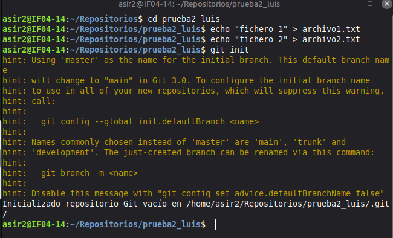
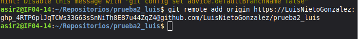
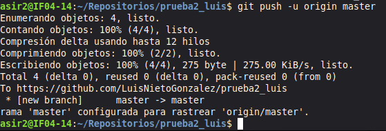
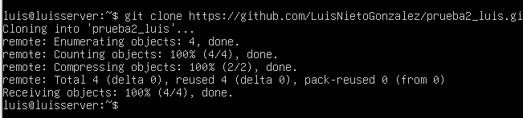
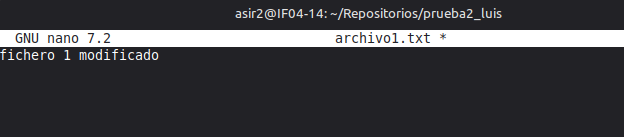
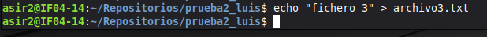
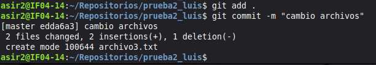
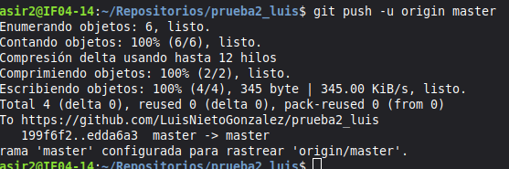
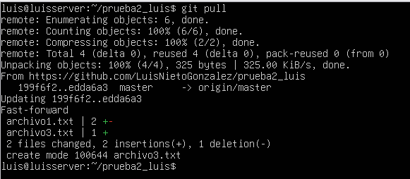

# Ejercicio 1 IAW

Vamos a crear un nuevo repositorio llamado **prueba2_luis**.

- vamos a crear primero el repositorio local usando
  *git init*. El repositorio debe contener, al menos, dos archivos de
  texto: *archivo1.txt* y *archivo2.txt*. El contenido de ambos archivos
  es libre.

- Conectamos el repositorio local con un repositorio remoto en
  GitHub usando *git remote add*.

- Subimos el repositorio local a GitHub usando *git push*.

- Clonamos el repositorio remoto en la máquina virtual Linux usando
  *git clone*.

- Modificamos uno de los archivos y añadimos un 3º archivo de
  texto llamado *archivo3.txt*.

- Confirmamos los cambios usando *git add*y
  *git commit* y lo subimos al repositorio usando *git push*.

- Actualizamos la versión local del repositorio en Linux Debian usando
  *git pull*.

