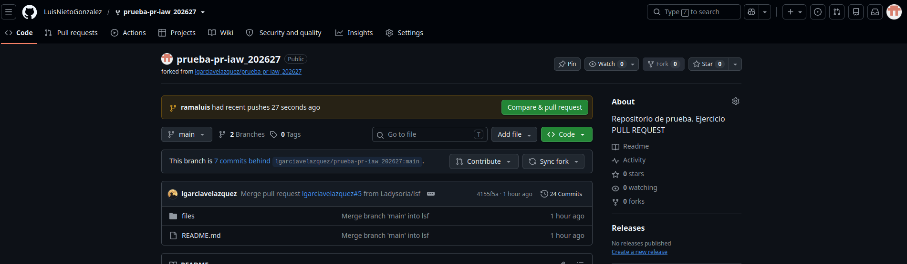

# Ejercicio: Pull Request en GitHub
 
Un **pull request** es una petición que le haces al dueño de un repositorio para que incorpore tus cambios. En este ejercicio el repositorio original es `lgarciavelazquez/prueba-pr-iaw_202627` y hay que pedir dos cambios:
 
1. Añadir un enlace con mis iniciales en el `README.md`.
2. Crear mi fichero `LNG.md` en la carpeta `files`.
---
 
## Paso 1: Hacer un fork del repositorio
 

 
No puedo cambiar directamente el repositorio del profesor, así que primero hago un **fork**: una copia del repositorio en mi propia cuenta. Se ve arriba, donde pone `LuisNietoGonzalez / prueba-pr-iaw_202627`. Esa copia es mía y puedo modificarla libremente.
 
Después clono mi fork en el ordenador y creo una **rama nueva** (en mi caso `ramaluis`) para trabajar en ella sin tocar `main`. Este paso no sale en las capturas, pero el comando es `git checkout -b ramaluis`.
 
---
 
## Paso 2: Modificar el `README.md`
 

 
Abro el `README.md` con `nano` y añado una línea nueva al final de la lista, con mis iniciales y un enlace a mi fichero:
 
```markdown
* [LNG](files/LNG.md)
```
 
Lo que va entre corchetes es el texto que se ve (mis iniciales) y lo que va entre paréntesis es la ruta del fichero al que lleva el enlace.
 
---
 
## Paso 3: Crear mi fichero `LNG.md`
 

 
Creo el fichero `LNG.md` dentro de la carpeta `files` y respondo a las tres preguntas: ¿quién eres?, ¿qué asignatura te gusta más? y ¿por qué?
 
Uso varias marcas de Markdown, más de las 5 que pide el enunciado:
 
- Títulos con `#` y `##`
- Negrita con `**texto**`
- Cursiva con `*texto*`
- Lista con guiones
- Cita con `>`
- Lista numerada
---
 
## Paso 4: Commit y push
 

 
Guardo los cambios y los subo a GitHub con estos comandos:
 
```bash
git add .
git commit -m "añado mi md"
git push --set-upstream origin ramaluis
```
 
- `git add .` prepara todos los cambios.
- `git commit -m "..."` los guarda con un mensaje. Aquí se ve que se cambiaron **2 ficheros** y que se creó `LNG.md`.
- `git push` sube la rama a GitHub. La primera vez dio un error porque la rama no tenía *upstream* (no sabía a qué rama remota subirse), así que Git me indicó el comando correcto con `--set-upstream`, y ya funcionó.
---
 
## Paso 5: GitHub me ofrece crear el pull request
 

 
Al entrar en mi fork, GitHub detecta que acabo de subir una rama nueva y muestra el aviso amarillo con el botón verde **Compare & pull request**. Pulso ese botón para empezar la petición.
 
En esta captura también aparece **"This branch is 7 commits behind"**: significa que el repositorio del profesor tiene cambios más nuevos que mi fork. Esto es normal porque mis compañeros también van enviando los suyos.
 
---
 
## Paso 6: Pull request creado
 

 
Aquí está el pull request **#16**, con estado **Open** (abierto):
 
- Pide fusionar mi rama `LuisNietoGonzalez:ramaluis` en la rama `main` de `lgarciavelazquez`.
- Aparece el commit `añado mi md`.
- GitHub confirma **"No conflicts with base branch"**: mis cambios se pueden unir sin ningún conflicto.
Ahora solo queda **esperar a que el profesor lo acepte**.
 
---
 
## Paso final: Sincronizar mi repositorio
 
Cuando el profesor acepte el pull request, tengo que traerme los ficheros de todos mis compañeros. Hay dos formas:
 
- En GitHub, con el botón **Sync fork** de mi fork.
- En la terminal, con estos comandos:
```bash
git remote add upstream https://github.com/lgarciavelazquez/prueba-pr-iaw_202627.git
git checkout main
git pull upstream main
```
 
---
 
## Resumen del orden
 
| Orden | Qué hago | Captura |
|-------|----------|---------|
| 1 | Hago el fork | `paso1_fork.png` |
| 2 | Edito el `README.md` | `paso2_readme.png` |
| 3 | Creo `LNG.md` | `paso3_fichero_md.png` |
| 4 | Commit y push | `paso4_commit_push.png` |
| 5 | Pulso *Compare & pull request* | `paso5_github_banner.png` |
| 6 | Pull request abierto | `paso6_pull_request.png` |
 

