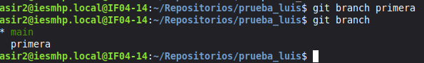
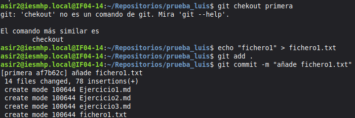
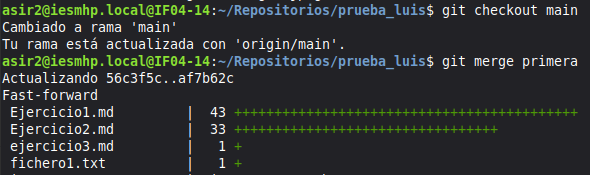

# Ejercicio 3: ramas, fusiones y conflictos en Git

## 1. Crear la rama `primera` y comprobarlo




El asterisco indica la rama activa (`main`). `primera` aparece en la lista, así que se ha creado.

## 2. Nuevo fichero en `primera` y fusión con la principal





```bash
git checkout primera
echo "nuevo" > nuevo.txt
git add .
git commit -m "añade nuevo.txt"
git checkout main
git merge primera
```

Salida de la fusión:

```
Updating 944bfca..9abf305
Fast-forward
 nuevo.txt | 1 +
 1 file changed, 1 insertion(+)
 create mode 100644 nuevo.txt
```

**¿Hubo conflicto? No.** Mientras trabajaba en `primera`, `main` no recibió ningún commit nuevo, de modo que `main` era un ancestro directo de `primera`. Git solo tuvo que avanzar el puntero de `main` hasta el último commit de `primera` (*fast-forward*), sin combinar cambios distintos. Además, el único cambio fue añadir un fichero nuevo, que no toca ningún contenido existente.

## 3. Borrar la rama `primera`

```bash
git branch -d primera
git branch
```

```
Deleted branch primera (was 9abf305).
* main
```

## 4. Rama `segunda` y conflicto

Se modifica la misma línea de `datos.txt` en `segunda` y en `main`:

```bash
git checkout -b segunda
echo "cambio desde segunda" > datos.txt
git commit -am "cambia datos en segunda"

git checkout main
echo "cambio desde main" > datos.txt
git commit -am "cambia datos en main"

git merge segunda
```

Salida:

```
Auto-merging datos.txt
CONFLICT (content): Merge conflict in datos.txt
Automatic merge failed; fix conflicts and then commit the result.
```

Contenido de `datos.txt` con el conflicto:

```
<<<<<<< HEAD
cambio desde main
=======
cambio desde segunda
>>>>>>> segunda
```

## 5. Resolución del conflicto y sincronización con GitHub

Se edita `datos.txt`, se eliminan los marcadores y se conservan ambos cambios:

```
cambio desde main
cambio desde segunda
```

```bash
git add datos.txt
git commit -m "Resuelve conflicto entre main y segunda"
git log --oneline --graph
```

```
*   2049411 Resuelve conflicto entre main y segunda
|\
| * 8770b84 cambia datos en segunda
* | 92af971 cambia datos en main
|/
* 9abf305 añade nuevo.txt
* 944bfca commit inicial
```

Sincronización con el remoto (repositorio `prueba_tu_nombre`):

```bash
git remote add origin https://github.com/<tu_usuario>/prueba_tu_nombre.git
git push -u origin main
git push -u origin segunda
```

### Captura de pantalla

> Pega aquí la captura de GitHub donde se vea la rama `segunda`:
>
> ``
