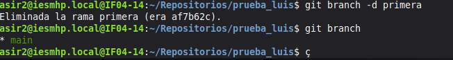
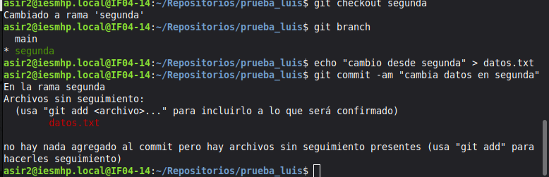
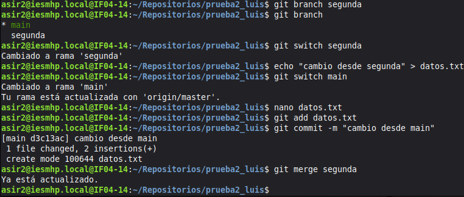

# Ejercicio 3: ramas, fusiones y conflictos en Git

## 1. Crear la rama `primera` y comprobarlo


El asterisco indica la rama activa (`main`). `primera` aparece en la lista, así que se ha creado.

## 2. Nuevo fichero en `primera` y fusión con la principal


**¿Hubo conflicto?** No porque un conflicto solo aparece cuando dos ramas cambian lo mismo (la misma línea del mismo fichero) y Git no sabe con cuál quedarse. Aquí solo se cambió una rama: en primera añadí un fichero nuevo y en main no hice nada. 

## 3. Borrar la rama `primera`




## 4. Rama `segunda` y conflicto

Se modifica la misma línea de `datos.txt` en `segunda` y en `main`:






Salida:

```
Auto-merging datos.txt
CONFLICT (content): Merge conflict in datos.txt
Automatic merge failed; fix conflicts and then commit the result.
```

Contenido de `datos.txt` con el conflicto:

```
<<<<<<< HEAD
cambio desde main
=======
cambio desde segunda
>>>>>>> segunda
```

## 5. Resolución del conflicto y sincronización con GitHub
no lo he conseguido realizar pero seria de esta forma:

Se edita `datos.txt`, se eliminan los marcadores y se conservan ambos cambios:
 
```
cambio desde main
cambio desde segunda
```
 
```bash
git add datos.txt
git commit -m "Resuelve conflicto entre main y segunda"
git log --oneline --graph
``` 
 
Sincronización con el remoto (repositorio `prueba_tu_nombre`):
 
```bash
git remote add origin https://github.com/<tu_usuario>/prueba_tu_nombre.git
git push -u origin main
git push -u origin segunda
```


